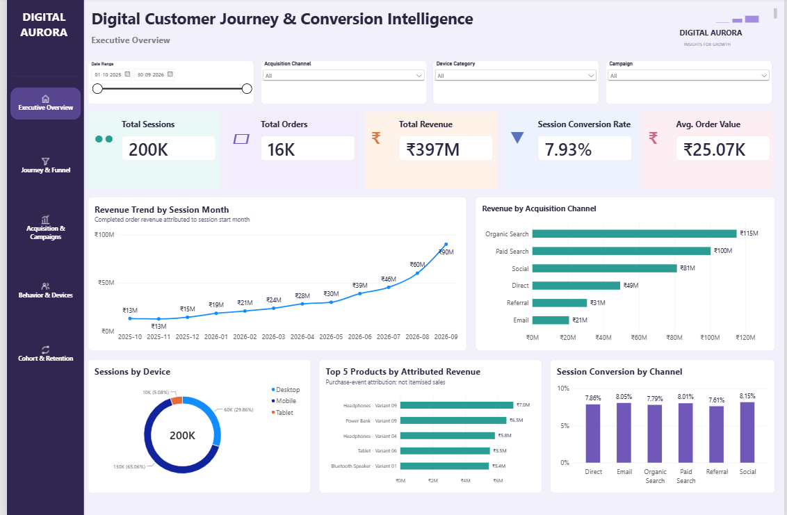
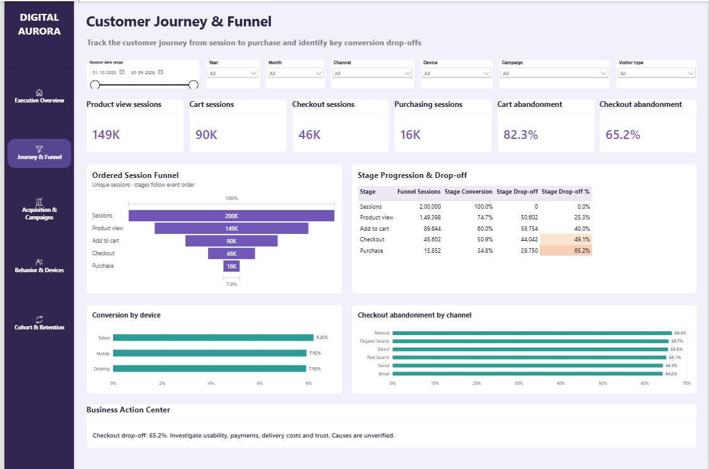
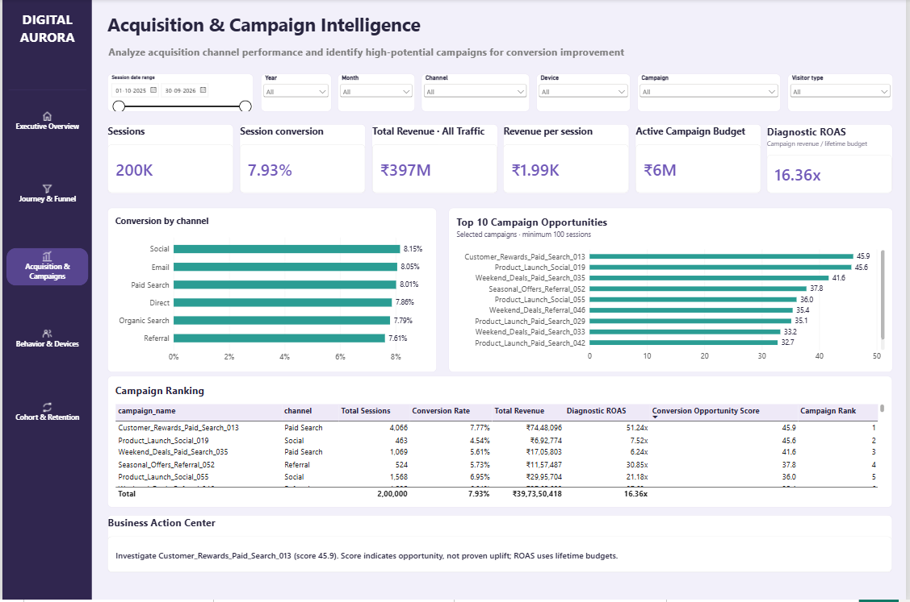
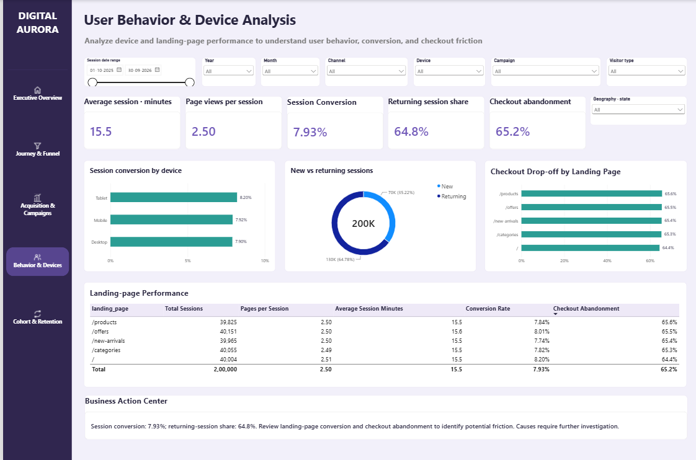
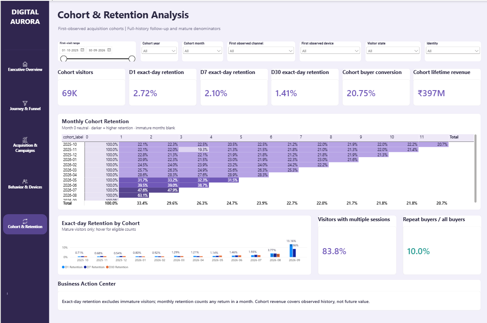

# Digital Customer Journey & Conversion Intelligence

### End-to-End Customer Analytics | Python · MySQL · Power BI

An end-to-end data analytics project that analyzes digital customer journeys, acquisition performance, conversion funnels, user behavior, and retention using a simulated e-commerce dataset.

The project demonstrates how event-level customer activity can be transformed into actionable business intelligence through data preparation, SQL analysis, and interactive Power BI dashboards.

> **Data Disclaimer:** This is an independent portfolio project built using synthetic data. It does not represent the actual performance of any company or organization.

---

## 1. Business Problem

Digital businesses generate large volumes of customer interaction data, but understanding how these interactions translate into conversions and repeat engagement can be challenging.

This project addresses five analytical questions:

1. How are sessions, orders, revenue, and conversion rates changing over time?
2. At which stages of the customer journey do users drop off?
3. Which acquisition channels and campaigns contribute most effectively to conversions?
4. How do device types and landing pages influence user behavior?
5. How effectively do customers return and engage after their initial visit?

**Objective:** Build an integrated customer intelligence solution that supports acquisition optimization, funnel improvement, and retention analysis.

---

## 2. Technology Stack

| Technology | Purpose |
|---|---|
| Python (pandas, NumPy) | Synthetic data generation, preparation, feature engineering, and validation |
| MySQL | Relational data analysis, SQL queries, and analytical views |
| Power BI | Interactive dashboard development, data modeling, and DAX calculations |
| DAX | KPI measures, conversion analysis, and retention metrics |

---

## 3. Dataset Overview

The project uses simulated digital commerce data covering **October 2025 to September 2026**.

### Core Datasets

| Dataset | Description |
|---|---|
| Customers | Synthetic customer and visitor information |
| Campaigns | Acquisition campaign attributes |
| Products | Product reference information |
| Sessions | Customer browsing sessions and acquisition details |
| Events | Customer interaction and funnel events |
| Orders | Simulated purchases and revenue |
| Session Features | Session-level analytical metrics |
| Visitor Features | Visitor-level behavioral summaries |
| Cohort Activity | Customer activity organized for retention analysis |

Additional analytical tables support date dimensions, campaign attributes, funnel stages, and cohort calculations.

The datasets are synthetic and are intended to demonstrate analytical workflows rather than real-world business outcomes.

---

## 4. Project Workflow

### Phase 1 — Data Generation and Preparation

- Generated interconnected synthetic datasets representing customers, sessions, events, campaigns, products, and orders.
- Prepared session-level and visitor-level analytical features using Python.
- Created supporting dimensions for time-series, acquisition, funnel, and retention reporting.
- Implemented data validation checks to examine record consistency and relationships.

### Phase 2 — SQL Analysis

- Organized relational datasets for MySQL analysis.
- Developed analytical SQL queries covering customer activity, funnel progression, acquisition performance, and revenue.
- Included SQL scripts for schema creation, CSV import, analytical views, and validation.

### Phase 3 — Power BI Data Modeling

- Structured analytical tables and supporting dimensions.
- Developed DAX measures for customer engagement, conversion, revenue, and retention.
- Implemented interactive report navigation and filtering.

### Phase 4 — Dashboard Development

Created a five-page interactive Power BI dashboard titled **Digital Aurora — Customer Intelligence**.

---

## 5. Power BI Dashboard

### Page 1 — Executive Overview



Provides a consolidated view of digital business performance.

**Key Metrics**
- Total Sessions
- Total Orders
- Total Revenue
- Conversion Rate
- Average Order Value (AOV)

**Analysis**
- Monthly performance trends
- Acquisition channel contributions
- Device-level performance
- Product performance

### Page 2 — Customer Journey & Funnel



Examines customer progression through the conversion journey.

**Analysis**
- Funnel stage volumes
- Stage-to-stage conversion
- Customer drop-off points
- Funnel improvement opportunities

### Page 3 — Acquisition & Campaign Intelligence



Evaluates acquisition channels and campaign performance.

**Analysis**
- Channel-level conversion performance
- Campaign comparisons
- Conversion opportunity scoring
- Campaign ranking and diagnostic return-on-ad-spend analysis

**Note:** Financial efficiency metrics based on simulated campaign inputs are illustrative and should not be interpreted as verified advertising performance.

### Page 4 — User Behavior & Device Analysis



Explores how customers interact with the digital platform.

**Analysis**
- Session-level engagement
- Landing-page performance
- Device segmentation
- Behavioral patterns associated with conversion

### Page 5 — Cohort & Retention Analysis



Measures customer return activity across cohorts.

**Analysis**
- D1, D7, and D30 exact-day retention
- Monthly cohort comparisons
- Retention heatmap
- Return-engagement patterns

**Note:** Retention calculations must account for the available observation window. Recent cohorts may not have enough follow-up time to support every retention interval.

---

## 6. Key Performance Indicators

| KPI | Definition |
|---|---|
| Sessions | Total recorded browsing sessions |
| Orders | Total completed purchase orders |
| Revenue | Total revenue from qualifying orders |
| Conversion Rate | Converted sessions divided by total eligible sessions |
| Average Order Value | Revenue divided by completed orders |
| Funnel Conversion | Progression from one journey stage to the next |
| Drop-off Rate | Percentage of users or sessions not progressing to the next stage |
| D1 Retention | Eligible users returning exactly one day after their initial activity |
| D7 Retention | Eligible users returning exactly seven days after their initial activity |
| D30 Retention | Eligible users returning exactly thirty days after their initial activity |

Detailed metric definitions and implementation notes are available in `DOCS/KPI_DEFINITIONS.md`.

---

## 7. Analytical Insights and Business Applications

The dashboard is designed to support the following analytical decisions:

**Conversion Funnel Optimization**

Identify journey stages with substantial customer drop-off and prioritize areas for further investigation.

**Acquisition Performance Analysis**

Compare channels and campaigns using conversion and engagement metrics rather than relying exclusively on traffic volume.

**User Experience Improvement**

Analyze differences in behavior across devices and landing pages to identify potential experience-related issues.

**Retention Monitoring**

Evaluate return engagement across customer cohorts while accounting for observation-window limitations.

**Revenue Performance Tracking**

Monitor how sessions, conversions, order volume, and average order value contribute to overall revenue.

These are analytical use cases. Specific findings from the simulated dataset should be interpreted in the context of the project's assumptions.

---

## 8. Project Structure

```text
Digital-Customer-Journey-Conversion-Intelligence/
│
├── DATA/
│   ├── customers.csv
│   ├── campaigns.csv
│   ├── products.csv
│   ├── sessions.csv
│   ├── events.csv
│   ├── orders.csv
│   ├── sessions_mysql.csv
│   ├── session_features.csv
│   ├── visitor_features.csv
│   ├── orders_clean.csv
│   ├── cohort_activity.csv
│   ├── date_dimension.csv
│   ├── campaign_dimension.csv
│   ├── funnel_stages.csv
│   └── month_offsets.csv
│
├── PYTHON/
│   ├── generate_customers.py
│   ├── generate_campaigns.py
│   ├── generate_products.py
│   ├── generate_sessions.py
│   ├── generate_events.py
│   ├── validate_events.py
│   ├── final_data_validation.py
│   ├── prepare_sessions_mysql.py
│   ├── prepare_data.py
│   ├── check_project.py
│   └── requirements.txt
│
├── SQL/
│   ├── customer_journey_analysis.sql
│   ├── 01_schema.sql
│   ├── 02_import_csv.sql
│   ├── 03_analytics_views.sql
│   └── 04_validation.sql
│
├── POWERBI/
│   ├── DigitalAurora.pbip
│   ├── DigitalAurora.Report/
│   └── DigitalAurora.SemanticModel/
│
├── IMAGES/
│   ├── 01_Executive_Overview.png
│   ├── 02_Customer_Journey_Funnel.png
│   ├── 03_Acquisition_Campaigns.png
│   ├── 04_User_Behavior_Devices.png
│   └── 05_Cohort_Retention.png
│
├── DOCS/
│   ├── DATA_DICTIONARY.md
│   ├── KPI_DEFINITIONS.md
│   ├── FINDINGS.md
│   ├── LIMITATIONS.md
│   ├── DAX_Measures.dax
│   └── schemas.json
│
└── README.md
```

---

## 9. How to Explore the Project

1. Review the `DATA` directory for the synthetic datasets.
2. Examine the `PYTHON` directory for generation, preparation, and validation scripts.
3. Explore the `SQL` directory for database structure and analytical queries.
4. Open the Power BI project using `POWERBI/DigitalAurora.pbip` in a compatible version of Power BI Desktop.
5. Review the five dashboard screenshots in `IMAGES`.
6. Refer to `DOCS` for data definitions, KPI methodology, analytical findings, and limitations.

**Power BI setup:** Local data source paths or credentials may need to be updated when opening the project on another computer.

---

## 10. Limitations

- All data is synthetically generated and does not represent actual customer behavior.
- Simulated campaign metrics are illustrative and do not establish real advertising effectiveness.
- Behavioral patterns are influenced by the assumptions used during data generation.
- Retention results depend on cohort eligibility and the available observation period.
- The project demonstrates descriptive and diagnostic analytics; it does not establish causal relationships.
- Data source configuration may require adjustments when reproducing the Power BI report.

---

## 11. Project Outcome

Developed an end-to-end customer analytics portfolio project integrating Python, MySQL, and Power BI.

The solution brings together customer journey analysis, conversion funnel monitoring, acquisition intelligence, user behavior segmentation, and cohort retention reporting in a unified interactive dashboard.

**Focus Areas:** Data Preparation · SQL Analytics · Data Modeling · DAX · Business Intelligence · Conversion Analytics · Customer Retention

---

**Project Type:** Independent Data Analytics Portfolio Project  
**Dataset:** Synthetic / Simulated  
**Dashboard:** Digital Aurora — Customer Intelligence